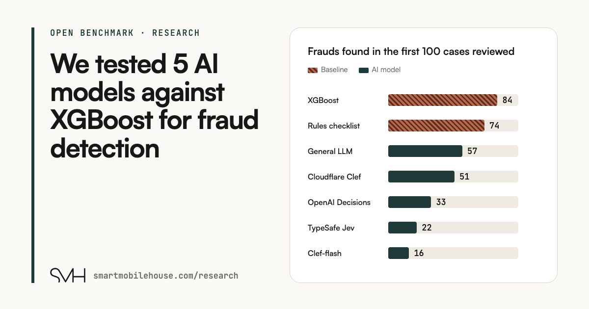

<p align="center">
  <picture>
    <source media="(prefers-color-scheme: dark)" srcset="assets/logo-dark.svg">
    
  </picture>
</p>
<h1 align="center">Fraud Decision Lab</h1>
<p align="center">
  <strong>An open, reproducible benchmark of AI decision APIs against XGBoost for payment-fraud triage.</strong><br>
  In the first 100 reviews of 10,000 synthetic transactions, XGBoost found 84 frauds; the best AI approach found 57.
</p>

<div align="center">

[](LICENSE)
[](https://doi.org/10.5281/zenodo.24246952)
[](https://smartmobilehouse.com)

</div>

<p align="center">
  <a href="https://smartmobilehouse.com/research/fraud-decision-lab/"></a>
</p>

## Results

Report v1.0 (runs of 6 November 2026). Full write-up with charts and confidence intervals: [We tested 5 AI models against XGBoost for fraud detection](https://smartmobilehouse.com/research/fraud-decision-lab/).

| Measure | XGBoost | Rules checklist | Best AI approach | Decision APIs |
| :--- | :--- | :--- | :--- | :--- |
| Frauds in the first 100 reviews (synthetic, 310 frauds in 10,000) | 84 | 74 | 57 (general LLM) | 16–51 |
| Share of fraud in the top 1% (ULB card data, 52 frauds) | 82.7% | — | 46.2% | — |
| Median latency | local | local | — | 175–324 ms |
| Cost per 1,000 synthetic transactions | local | local | — | $0.016–$0.10 |

XGBoost learned from labelled history; the AI approaches ran zero-shot. The synthetic labels share risk factors with the rules, which flatters the rules. See [Notes & limitations](#notes--limitations).

The current source distribution contains no benchmark result files. Older Git
history contains results text and screenshots, so changing the original private
repository's visibility is **not** a source-only release. See
[`RELEASE.md`](RELEASE.md) for a reviewable source snapshot without that history.

Run `make demo` for a synthetic offline example. `fraudlab report` and
`fraudlab export-report-data` require a dataset approved for publication; they
do not make a legal determination. Results from unapproved datasets remain local
run artifacts. A source-only release does not provide public Level 3 verification
of historical paid experiments. Retained research claims need separately reviewed
prediction evidence and provenance.

## What it compares

| Model | How it scores a transaction | Runs |
|---|---|---|
| **XGBoost** | Supervised gradient-boosted trees, trained on labelled history | Locally |
| **Rules** | A transparent, hand-written risk score | Locally |
| **TypeSafe Jev** | Zero-shot decision model (System One API) | Via API |
| **OpenAI Decisions** | Zero-shot decision endpoint | Via API |
| **Cloudflare Clef / Clef-flash** | Zero-shot decision models on Workers AI | Via API |
| **Structured-output LLM** | A general LLM forced into a strict JSON score | Via API |

Models use the **same configured feature schema**. API providers receive a
shared fraud question and field descriptions through provider-specific formats;
numeric payloads are rounded to four decimals. Rules and XGBoost use the original
dataframe values, and XGBoost learns from labelled training history. These are
intentional differences, not identical model inputs.

Metrics include average precision (labelled PR-AUC), recall at the top 1% and
5%, precision and fraud count at the top 1%, and paired bootstrap differences
from XGBoost. The top 1% is 100 cases only when 10,000 cases are evaluated.
Operational summaries distinguish eventual completion from earlier attempts;
API costs are calculated from usage and a dated price snapshot, not invoices.

## Quick start

No API keys, no dataset downloads and no paid calls are needed.

```bash
git clone https://github.com/SmartMobileHouse/fraud-decision-lab
cd fraud-decision-lab
uv sync --frozen        # install pinned dependencies (Python 3.12)
uv run fraudlab doctor  # check your setup; prints no secrets
```

See it work in one command (about 5 seconds, offline):

```bash
make demo               # rules + XGBoost on the bundled synthetic data -> outputs/demo-report.html
```

Or with Docker / Podman only:

```bash
make docker
container=$(docker create --network none fraud-decision-lab demo)
docker start --attach "$container"
mkdir -p outputs
docker cp "$container:/app/outputs/." outputs/
docker rm "$container"
```

The report is saved to `outputs/demo-report.html`. Copying the output works with
Docker and Podman VMs without sharing the host project directory. Bind mounts
require that the engine can access the host path and the container user can write
to it; an external drive is not automatically shared with every VM.

Then run the offline benchmark on the bundled synthetic data and build the report:

```bash
uv run fraudlab run -d configs/datasets/synthetic.yaml --providers rules,xgboost
uv run fraudlab report --run-id <run_id printed above> --out outputs/report.html
```

Live providers need API keys, `--allow-external-requests` and a `--max-cost-usd`
spending estimate; see `uv run fraudlab run --help`. The estimate is not a
provider-enforced billing cap: tokenization, retries and uncertain billing can
cause differences. Use available provider-side spending controls as well.

## Configuration

Live provider runs read credentials from a local `.env` file (gitignored).
Copy the template and fill in only the providers you want to run:

```bash
cp .env.example .env && chmod 600 .env
```

| Variable | Provider |
|---|---|
| `TYPESAFE_API_KEY` | TypeSafe Jev |
| `OPENAI_API_KEY` | OpenAI Decisions and the structured-output LLM |
| `CLOUDFLARE_ACCOUNT_ID`, `CLOUDFLARE_API_TOKEN` | Cloudflare Clef / Clef-flash (Workers AI Read + Edit) |

The reference adapters request `jev-1.14.0`, `gpt-6-luna` (Decisions and LLM),
`@cf/cloudflare/clef`, and `@cf/cloudflare/clef-flash`. A reported identifier
does not freeze a provider's server implementation; the OpenAI and Cloudflare
identifiers are not immutable execution snapshots. The structured-output LLM
uses reasoning effort `none`, a 64-token output limit, and a strict JSON score.
Sampling parameters not explicitly sent are provider-controlled defaults.
The fraud question is in [`configs/questions-v1.json`](configs/questions-v1.json);
adapters in `src/fraudlab/providers/` define the request-specific wrappers.

Only the project's original synthetic data is bundled. Download third-party
datasets yourself into `data/external/` (see
[`DATA_LICENSES.md`](DATA_LICENSES.md)); `fraudlab doctor` shows what it finds.

### IEEE-CIS Fraud Detection

This repository includes optional support for the IEEE-CIS Fraud Detection dataset.

The dataset is not distributed with this project. Users must obtain it independently from Kaggle and comply with the original competition rules, including restrictions on commercial use.

The benchmark implementation is provided separately from the dataset.

The included IEEE-CIS configs are local-only (`external_processing_allowed: false`).
Publication is separately disabled (`publication_allowed: false`): this includes
aggregate results, plots, cached outputs and reports pending independent rights
review. API-processing permission is not publication permission. The shipped ULB
config allows publishing aggregate results under its ODbL/DbCL licence with
attribution (see [`DATA_LICENSES.md`](DATA_LICENSES.md)). Do not enable publication
merely to bypass a report refusal.

## Status

- [x] Offline demo on bundled synthetic data (`make demo`, no keys, about 5 seconds)
- [x] XGBoost and rules baselines
- [x] Adapters for TypeSafe Jev, OpenAI Decisions, Cloudflare Clef / Clef-flash and a structured-output LLM
- [x] Review-queue metrics (top 1% / 5%, PR-AUC) with paired bootstrap ranges
- [x] Spending guard for live runs (`--allow-external-requests`, `--max-cost-usd`)
- [x] Costs from recorded token usage and a dated price snapshot
- [x] `fraudlab replay` for saved run metrics
- [x] Per-dataset processing and publication gates
- [x] Docker / Podman image that runs without network

## Development

```bash
uv sync --frozen
make check      # ruff, mypy, pytest (offline), license check, gitleaks secret scan
make format     # auto-fix lint and formatting
make docker     # build the offline image
make help       # list all targets
```

There is no hosted CI: run `make check` before every push. Tests can never
reach the network; tests that call a real paid API are marked `live` and never
run by default. See [`CONTRIBUTING.md`](CONTRIBUTING.md).

## Notes & limitations

- **Zero-shot vs supervised.** XGBoost learns from labelled history; the AI
  models see each transaction cold. That is deliberate, and the report says so.
- **Dataset realism.** Synthetic history fields and labels are generated signals,
  not observed card histories or validated banking outcomes. ULB's anonymised
  components limit semantic interpretation by a zero-shot model. Repeated feature
  vectors can cross chronological splits; identical vectors alone do not prove
  duplicate transactions. No entity-independent evaluation is claimed.
- **Uncertainty.** Confidence intervals resample transactions with class counts
  fixed. They condition on saved predictions and ignore customer/day clustering,
  provider rerun variability and future distribution shift. A single saved run
  cannot establish a stable general ranking of vendors.
- **Not a production fraud system.** A fraud score is not a calibrated
  probability and not a decision to block a card or account. Analysts must review
  cases; false positives and false negatives carry different operational costs.
- **Data rights are yours.** MIT covers this project's code and its synthetic
  data only, never a third-party dataset. Some datasets (for example IEEE-CIS)
  must not be sent to external APIs; the lab blocks that by configuration.
- **Privacy and manipulated inputs.** Approved live runs transmit configured
  fields to providers. Confirm data rights, retention terms and privacy controls
  before sending real records. Transaction text can contain prompt injection;
  robustness against adversarial inputs has not been demonstrated. Models do
  not execute financial actions. Run logs support research inspection, not
  regulatory certification or a complete production audit trail.
- **Providers change.** Models, prices and APIs move; every result is tied to
  its run date and manifest.
- **Reproducibility.** `fraudlab replay` checks supported saved run metrics against
  saved labels and predictions. It does not authenticate provider execution,
  verify invoices, or recover missing historical load-test calls. Legacy runs
  may have incomplete provenance and cannot safely be resumed as new experiments.
  Retraining XGBoost can give slightly different numbers on another operating
  system or CPU; each run records its platform.
- **Platforms and setup.** The pinned project targets Python 3.12 on macOS and
  Linux. Dependency installation and Docker builds need downloads unless cached.
  Image tags and system package repositories are mutable; the Dockerfile is not
  a bit-for-bit frozen image recipe.
- This is an independent project and is not affiliated with or endorsed by
  TypeSafe, OpenAI, Cloudflare, Kaggle or the dataset owners.

## How to cite

If you use this benchmark or its results, please cite the report:

> Pietruszewski, J. (2026). *We tested 5 AI models against XGBoost for fraud detection. Here's what they caught* (report version 1.0). Smart Mobile House. https://smartmobilehouse.com/research/fraud-decision-lab/

The code is archived on Zenodo: [doi:10.5281/zenodo.24246952](https://doi.org/10.5281/zenodo.24246952) (all versions). GitHub's **Cite this repository** button gives APA and BibTeX.

```bibtex
@techreport{pietruszewski2026frauddecisionlab,
  author      = {Pietruszewski, Jerzy},
  title       = {We tested 5 AI models against XGBoost for fraud detection. Here's what they caught},
  institution = {Smart Mobile House},
  year        = {2026},
  type        = {Report},
  number      = {version 1.0},
  url         = {https://smartmobilehouse.com/research/fraud-decision-lab/}
}

@software{pietruszewski2026frauddecisionlab_code,
  author    = {Pietruszewski, Jerzy},
  title     = {Fraud Decision Lab: a reproducible benchmark of AI decision models vs XGBoost for payment-fraud ranking},
  year      = {2026},
  publisher = {Zenodo},
  doi       = {10.5281/zenodo.24246952},
  url       = {https://github.com/SmartMobileHouse/fraud-decision-lab}
}
```

## Contributing

Issues and pull requests are welcome; see [CONTRIBUTING.md](CONTRIBUTING.md). Report security issues as described in [SECURITY.md](SECURITY.md).

## Why Fraud Decision Lab?

### Fraud teams can review only a small share of transactions

The useful measure is how much fraud lands in the slice analysts can actually review, for example the top 1% of a queue, and what each model costs to get there.

### Vendor claims are hard to compare

- Decision-model APIs launched in 2026 are pitched for fraud triage with "no training needed".
- Published comparisons rarely use the same transactions, the same fields and the same review budget, and few can be rerun.

### This lab measures them side by side

- The same transactions and the same configured feature schema for every model; input differences are documented.
- Metrics tied to review capacity, with bootstrap ranges.
- Offline by default; live calls are opt-in and cost-guarded.
- Every run saves predictions, metadata and costs, so results can be checked.

## License

[MIT](LICENSE) © Smart Mobile House. Built and maintained by [Smart Mobile House](https://smartmobilehouse.com).

The Smart Mobile House name is a trademark of Smart Mobile House and is not
licensed under MIT. Generated reports remain subject to dataset, provider and
other applicable rights; the code license does not grant publication permission.
